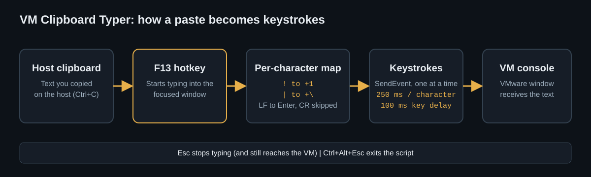
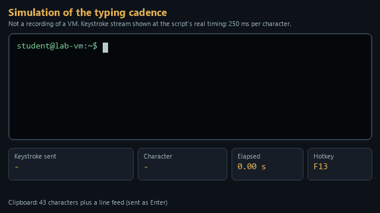

# VM Clipboard Typer

*Types your clipboard into VMware consoles that don't accept paste, one exact keystroke at a time.*

## What it is

VM Clipboard Typer is a small [AutoHotkey v2](https://www.autohotkey.com/) utility for Windows. Press **F13** and it types whatever is on your clipboard into the window that has focus, one keystroke at a time. It is meant for VM consoles that do not accept host clipboard paste: instead of pasting, it sends the text as ordinary keystrokes.

*The animation above is a simulation of the typing cadence (a 250 ms pause per character), not a recording of a VM.*

## Why I built it

This is a personal lab utility I built during cybersecurity bootcamp lab work in VMware. The VM console would not accept pasted text from the host, and the lab commands were long and intricate. Typing them by hand was slow and easy to get wrong. With this script I copy the command on the host and let it type the string exactly as written, which removes typing errors and speeds up lab work.

## How to use

1. Install [AutoHotkey v2](https://www.autohotkey.com/).
2. Run `VM Clipboard Typer.ahk` (double-click it, or open it with AutoHotkey v2).
3. Copy the text you want to type on the host (Ctrl+C).
4. Click into the VM console so it has focus.
5. Press **F13**. The text is typed into the console one character at a time.
6. Press **Esc** to stop typing at any point. Esc still passes through to the VM.
7. Press **Ctrl+Alt+Esc** to exit the script.

Tooltips report what is happening: *Clipboard is empty*, *Typing stopped.* and *Typing complete.*

## Features

- Types the clipboard into the focused window as individual keystrokes (`SendEvent`).
- Maps shifted symbols explicitly, so US-layout symbols arrive correctly in consoles that drop or mistranslate them.
- Converts line feeds to Enter and skips carriage returns, so multi-line text works.
- Converts "smart" punctuation (curly quotes, en and em dashes, non-breaking spaces) to plain ASCII equivalents.
- Esc stops typing immediately (before the next character) and still reaches the VM.
- Ctrl+Alt+Esc exits the script.
- Tooltips for empty clipboard, stopped and complete.

## How it works

For each character in the clipboard, the script sends one keystroke and then waits. Shifted symbols are sent as Shift plus the base key on a US keyboard layout:

| Character | Keystroke sent | Character | Keystroke sent |
|-----------|----------------|-----------|----------------|
| `!` | `+1` | `_` | `+-` |
| `@` | `+2` | `+` | `+=` |
| `#` | `+3` | `{` | `+[` |
| `$` | `+4` | `}` | `+]` |
| `%` | `+5` | `\|` | `+\` |
| `^` | `+6` | `:` | `+;` |
| `&` | `+7` | `<` | `+,` |
| `*` | `+8` | `>` | `+.` |
| `(` | `+9` | `?` | `+/` |
| `)` | `+0` | `~` | ``+` `` |
| `"` | `+'` | space | `{Space}` |

In this table `+` means Shift. Letters, digits, `-` and `'` are sent as they are.

**Timing.** `SetKeyDelay 0, 100` sets a 100 ms key delay, and the script sleeps 250 ms after every character. Typing is deliberately slow so the VM console can keep up.

**Line endings.** A line feed (`\n`) is sent as Enter. A carriage return (`\r`) is skipped, so Windows-style line endings do not produce double Enters.

## Tips and limitations

- **US keyboard layout assumed.** The symbol mapping targets a US layout in the VM. Other layouts may need different mappings.
- **F13 needs a key.** Many keyboards have no F13 key. Use a programmable key or remap one to F13, or change the hotkey: in `VM Clipboard Typer.ahk`, edit the line `F13::{` to another key, for example `F9::{` or `^!v::{`.
- **Speed tuning.** To type faster or slower, change the `Sleep 250` after each character (milliseconds) and the second number in `SetKeyDelay 0, 100`. Lower values are faster but may drop characters in a slow console.
- **Focus matters.** The text goes to whichever window has focus when you press F13, so click into the VM console first.
- **Plain text only.** Only the text on the clipboard is typed.

## Built with

- [AutoHotkey v2](https://www.autohotkey.com/)

## License

Copyright (c) 2026 Casey Shingledecker. All rights reserved. Source-available for viewing and for personal, non-commercial running only; this is not open source. See [LICENSE](LICENSE). Other people's material keeps its own license.
